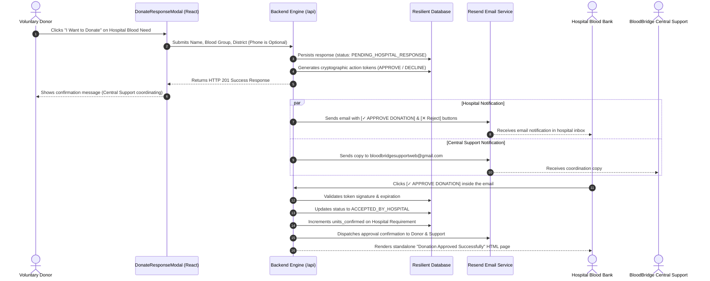
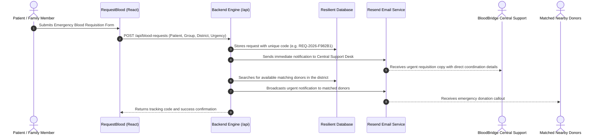

# BloodBridge – Smart Donor Connect 🩸

<div align="center">


[](https://react.dev/)
[](https://vitejs.dev/)
[](https://expressjs.com/)
[](https://tailwindcss.com/)
[](https://firebase.google.com/)
[](https://resend.com/)
[](https://supabase.com/)
[](https://opensource.org/licenses/MIT)

> **"Connecting Lives. One Drop at a Time."**  
> A mission-critical, modern healthcare platform connecting voluntary blood donors, patients in emergency need, and verified hospitals across all 38 districts of Tamil Nadu.

</div>

---

## 📌 Table of Contents

1. [Overview & Healthcare Vision](#-overview--healthcare-vision)
2. [Key Highlights & Architectural Innovations](#-key-highlights--architectural-innovations)
3. [Technology Stack](#️-technology-stack)
4. [System Architecture & Workflow Diagrams](#-system-architecture--workflow-diagrams)
5. [Complete Directory Structure](#-complete-directory-structure)
6. [Environment Variables Guide (.env)](#️-environment-variables-guide-env)
7. [Getting Started & Local Development](#-getting-started--local-development)
8. [Firebase Cloud Functions Setup](#-firebase-cloud-functions-setup)
9. [Managing Background Processes](#-managing-background-processes)
10. [Central Support Email & 1-Click Action System](#-central-support-email--1-click-action-system)
11. [Automated Verification & Test Suites](#-automated-verification--test-suites)
12. [Complete REST API Reference](#-complete-rest-api-reference)
13. [Database Schema & Data Models](#-database-schema--data-models)
14. [Design System & iOS Glassmorphism](#-design-system--ios-glassmorphism)
15. [Security, Privacy & Clinical Compliance](#-security-privacy--clinical-compliance)
16. [Troubleshooting & Frequently Asked Questions](#-troubleshooting--frequently-asked-questions)
17. [License & Acknowledgements](#-license--acknowledgements)

---

## 🌟 Overview & Healthcare Vision

In emergency medical scenarios—acute trauma resuscitation, high-risk obstetric hemorrhages, complex cardiac surgeries, and pediatric oncology transfusions—**every minute counts**. Despite millions of willing donors, hospitals and patient families frequently encounter critical shortages. The bottleneck is almost never donor willingness; it is **information fragmentation**, **cumbersome sign-up barriers**, and **communication latency** between clinical facilities and nearby donors.

**BloodBridge** was engineered from the ground up to solve these core challenges:

* **Eliminating Friction for Voluntary Donors**: Donors can step forward immediately to offer blood without forced mobile phone disclosures, account gatekeeping, or invasive sign-up surveys.
* **Direct Hospital Requisition Stream**: Verified hospital blood banks publish live requirements categorized by clinical urgency (`Emergency`, `Critical`, `Planned`), specifying blood group, units required, and deadline.
* **1-Click Transactional Email Triage**: Medical officers can accept or decline donation offers directly from their hospital email inbox with a single click—no password login or portal navigation required.
* **Central Support Coordination Engine**: All critical requests, offers, and approvals automatically dispatch copies to BloodBridge Central Support (`bloodbridgesupportweb@gmail.com`), ensuring patient families and hospitals are coordinated even if contact details are missing.
* **All 38 Districts of Tamil Nadu**: Comprehensive coverage of all healthcare centers across Chennai, Coimbatore, Madurai, Karur, Tiruchirappalli, Ariyalur, and beyond.
* **Ultra-Rare Bombay Blood Group (hh) Protocol**: Dedicated clinical protocol, access code verification, and audit logging to safely match the ultra-rare Bombay phenotype.

---

## ⚡ Key Highlights & Architectural Innovations

### 1. Hospital Blood Requirements & Live Urgency Triage
* Verified hospital accounts can publish active blood requirements directly from their clinical operations dashboard.
* Urgency tiers with visual cues:
  * 🚨 **Emergency**: Immediate transfusion needed (< 2 hours).
  * ⚠️ **Critical**: Surgery or ICU support within the day (< 12 hours).
  * 🗓️ **Planned**: Scheduled procedures or elective transfusions.
* Real-time requirement progress meters track confirmed vs. required units.
* Lifecycle states: `ACTIVE`, `PARTIALLY_FULFILLED`, `FULFILLED`, `EXPIRED`, `CANCELLED`.

### 2. Zero-Barrier Voluntary Donor Offer Flow (No Phone Gatekeeping)
* Donors can browse open requirements by district, urgency, and blood group.
* **Phone Number is 100% Optional**: Donors can submit an offer with just their Name, Blood Group, District, and an optional message.
* Verified profile details are pre-filled automatically for logged-in users; guest donors can submit instantly.
* Real-time client and server validation prevents duplicate submissions.

### 3. One-Click Tokenized Email Action Workflow (HMAC-SHA256)
* When a voluntary donor submits an offer, the backend generates cryptographic, single-use action tokens:
  * `✓ APPROVE DONATION`: Directly approves the offer, increments the hospital requirement's confirmed units, and notifies the donor and support desk.
  * `✕ Reject Donation`: Politely declines the offer with audit trail preservation.
* **No Login Required**: The medical officer simply clicks the button inside their email client.
* **Standalone Result Screen**: Renders a lightweight, high-performance HTML confirmation page requiring zero frontend dependencies or external assets.
* **Idempotency & Replay Protection**: Double clicks or repeated approvals safely return an informative "Already Processed" notification without corrupting database state.

### 4. Central Support Notification & Audit Desk
* Central Support Email: **`bloodbridgesupportweb@gmail.com`**
* Receives automated, high-priority transactional notifications for:
  1. Emergency Patient Blood Requests.
  2. Voluntary Donor Offers to Hospitals.
  3. Hospital Approvals and Rejections.
  4. Newly Published Hospital Blood Requirements.
  5. Rare Bombay Blood Group matching requests.
* **Missing Hospital Email Fallback**: When a hospital lacks a registered email address, the system gracefully bypasses delivery failure, persists the donation offer safely, and routes coordination directly to Central Support.

### 5. Ultra-Rare Bombay Blood Group (hh) Protocol
* The Bombay phenotype (hh) is present in approximately 1 in 10,000 individuals in India and can only receive blood from another hh donor.
* Specialized protected route (`/bombay-access`) requiring medical access credentials.
* Immutable audit logging (`server/data/bombay_audit.json`) tracks every search, request, and donor connection to prevent clinical mismatching.

### 6. Tamil Nadu 38-District Donor Search & Medical Compatibility Engine
* Complete database of all 38 districts of Tamil Nadu.
* Interactive ABO/Rh compatibility calculator:
  * Universal Donor: **O-**
  * Universal Recipient: **AB+**
  * Rh compatibility filters preventing invalid donor matches.
* Distance-weighted sorting to prioritize nearest active voluntary donors.

### 7. Emergency Patient Blood Requisitions (`/request-blood`)
* Open to public seekers, families, and attending doctors.
* Automatically creates a human-readable tracking code (e.g., `REQ-2026-A1B2C3`).
* Dispatches instantaneous alerts to matched nearby donors and Central Support.

### 8. Hospital Clinical Operations Portal (`/hospital-dashboard`)
* Dedicated hospital authentication using state-issued **Hospital Access Keys** (e.g., `TN01-ARIYA-001`) and bcrypt-hashed passwords.
* Requirement publication, unit requirement adjustments, donor offer triage, and donation completion tracking.
* Clinical audit records documenting unit collection times and medical compliance.

### 9. Donor Dashboard & Digital Recognition (`/donor-dashboard`)
* Availability toggle (`Available for Donations` / `Temporarily Inactive`).
* **90-Day Medical Cooldown Tracker**: Calculates remaining days until next eligible whole blood donation.
* **Digital Blood Donor Certificate**: Instant generation of personalized, downloadable PDF/image recognition certificates.
* Complete donation history log.

### 10. Signature Living Blood Canvas & iOS Glassmorphism UI
* **Fluid Physics Simulation**: Interactive HTML5 Canvas blood drop with spring physics, surface tension simulations, and cursor hover waves (`LivingBloodDrop.jsx`).
* **iOS Glassmorphism Design**: Deep `#050508` dark background, translucent frosted glass layers (`backdrop-blur-xl`), and vibrant crimson glow accents (`#E50914`).
* Responsive, high-contrast interface designed for rapid accessibility during high-stress medical emergencies.

### 11. Transactional Email Developer Playground (`/dev/email-test`)
* Interactive developer page for triggering and inspecting all system email templates in real time.
* Live status checks for the Resend API key and developer sandbox fallback routing.

---

## 🛠️ Technology Stack

```
┌────────────────────────────────────────────────────────────────────────┐
│                          CLIENT (BROWSER)                              │
│   React 19  •  Vite 5  •  Tailwind CSS  •  React Router 7  •  Lucide   │
└───────────────────────────────────┬────────────────────────────────────┘
                                    │ HTTP / JSON REST
                                    ▼
┌────────────────────────────────────────────────────────────────────────┐
│                        BACKEND ENGINE (NODE.JS)                        │
│   Express 5  •  JWT Auth  •  Bcrypt.js  •  Node Crypto (HMAC SHA-256)   │
└─────────────┬─────────────────────┬─────────────────────┬──────────────┘
              │                     │                     │
              ▼                     ▼                     ▼
┌──────────────────────┐ ┌──────────────────────┐ ┌──────────────────────┐
│     RESEND API       │ │  LOCAL JSON DATABASE │ │ SUPABASE POSTGRESQL  │
│ Transactional Emails │ │ High-Speed / Offline │ │ Cloud Relational DB  │
│  & Token Action URLs │ │   Resilient Storage  │ │   & RLS Security     │
└──────────────────────┘ └──────────────────────┘ └──────────────────────┘
```

| Layer | Technology | Version | Rationale & Responsibility |
| :--- | :--- | :--- | :--- |
| **Frontend Framework** | **React** | `^19.2.8` | Component-driven UI, concurrent rendering, dynamic state management. |
| **Build Tooling** | **Vite** | `^5.4.11` | Instant HMR development server, optimized ESM bundling, embedded proxy API. |
| **Styling & Theme** | **Tailwind CSS** | `^3.4.17` | Utility-first CSS, custom iOS glassmorphic layers, dark mode tokens. |
| **Icons & Visuals** | **Lucide React** | `^1.44.0` | Accessible, ultra-lightweight SVG healthcare icons. |
| **Routing** | **React Router** | `^7.18.3` | Client-side routing, query parameter handling, protected routes. |
| **Backend Runtime** | **Node.js** | `v18+` | Cross-platform JavaScript runtime for server and testing pipelines. |
| **Server Framework**| **Express** | `^5.2.1` | Embedded inside Vite dev server and runnable standalone on port `5000`. |
| **Email Delivery** | **Resend SDK** | `^6.32.0` | High-deliverability transactional emails with HTML templates and dev sandbox fallback. |
| **Security & Auth** | **Bcrypt.js & JWT**| `^3.0.3` / `^9.0.3` | Salted password hashing and signed JSON Web Tokens for hospital sessions. |
| **Cryptographic Tokens**| **Node Crypto** | Built-in | 256-bit cryptographic hex tokens for one-click email actions. |
| **Cloud Database** | **Supabase / Postgres**| `^2.109.0` | Production relational database, Row Level Security (RLS), automated triggers. |
| **Local Resilient DB**| **Local JSON Store** | Custom | High-speed, offline-capable file persistence with atomic writes. |

---

## 📐 System Architecture & Workflow Diagrams

### 1. Voluntary Donation Response & One-Click Approval Lifecycle



### 2. Emergency Blood Requisition & Dual-Dispatch Workflow



---

## 📁 Complete Directory Structure

```text
blood-bridge/
├── index.html                        # HTML5 entry point with Google Fonts (Outfit, Inter)
├── package.json                      # Project metadata, dependencies, and npm scripts
├── vite.config.js                    # Vite config with embedded Express API proxy
├── tailwind.config.js                # Custom Tailwind config (glass tokens, colors)
├── postcss.config.js                 # PostCSS configuration
├── firebase.json                     # Firebase project config (Functions + Firestore rules)
├── firestore.rules                   # Firestore security rules
├── .firebaserc                       # Firebase project alias (blood-bridge-135)
├── .env.example                      # Environment variable documentation template
├── .env                              # Active secrets (git-ignored)
│
├── docs/                             # 📁 Support & Reference Files
│   ├── README.md                     # Guide to all docs files
│   ├── supabase_schema.sql           # Complete Supabase PostgreSQL schema, RLS & triggers
│   ├── bloodbridge_38_districts_demo.json # Reference donor dataset (38 Tamil Nadu districts)
│   └── parse_hospitals.py            # Hospital data seeding utility script
│
├── tests/                            # 🧪 Manual QA Scripts (git-ignored, local only)
│   ├── test_central_support_comprehensive.js
│   ├── test_central_support_notifications.js
│   ├── test_donor_email_automation.js
│   ├── test_email_approval_flow.js
│   ├── test_no_phone_donation_response.js
│   └── verify_feature.js
│
├── functions/                        # 🔥 Firebase Cloud Functions (Deployed to Firebase)
│   ├── index.js                      # sendTestEmail (Callable) + sendTestEmailHttp (REST)
│   ├── package.json                  # Functions-only dependencies (firebase-functions, resend)
│   └── .env.example                  # Firebase Cloud Functions env template
│
├── public/                           # Static Assets
│   └── favicon.svg                   # Red blood drop SVG icon
│
├── src/                              # Frontend Application (React 19)
│   ├── main.jsx                      # React DOM root initialization
│   ├── App.jsx                       # Route architecture and ambient background styling
│   ├── index.css                     # Global styles, glassmorphic utilities, custom scrollbars
│   │
│   ├── lib/                          # SDK Client Initializers
│   │   ├── firebaseClient.js         # Firebase app, Firestore & Functions init (guarded)
│   │   └── supabaseClient.js         # Supabase client init with placeholder fallback
│   │
│   ├── components/                   # Reusable UI Components
│   │   ├── Navbar.jsx                # Role-aware responsive navigation bar
│   │   ├── Footer.jsx                # Footer with emergency hotlines and navigation links
│   │   ├── Logo.jsx                  # BloodBridge animated droplet logo
│   │   ├── DonateResponseModal.jsx   # Voluntary donation modal (zero mandatory phone)
│   │   ├── HospitalRequirementModal.jsx  # Detailed hospital requirement inspector
│   │   ├── LivingBloodDrop.jsx       # Interactive HTML5 Canvas fluid blood drop physics
│   │   ├── ProtectedRoute.jsx        # Role-based route authorization guard
│   │   ├── ScrollToTop.jsx           # Viewport reset on route transitions
│   │   ├── Toast.jsx                 # Floating glassmorphism notifications system
│   │   └── admin/
│   │       └── EmailAutomationTestPanel.jsx  # Admin email diagnostics panel
│   │
│   ├── pages/                        # Application Page Views
│   │   ├── Home.jsx                  # Landing page with stats, hero drop, and quick finder
│   │   ├── About.jsx                 # Mission, team, and 38-district healthcare reach
│   │   ├── FindBlood.jsx             # Donor search engine with compatibility matrix
│   │   ├── DonateBlood.jsx           # Live hospital blood requirements feed & triage
│   │   ├── RequestBlood.jsx          # Emergency blood requisition form
│   │   ├── MyRequests.jsx            # Seeker tracking dashboard
│   │   ├── Login.jsx                 # 3-way auth portal (Donor / Hospital / Admin)
│   │   ├── Register.jsx              # Donor & seeker registration
│   │   ├── Contact.jsx               # Support contact form & emergency contacts
│   │   ├── HospitalPortal.jsx        # Hospital accreditation application gateway
│   │   ├── HospitalDashboard.jsx     # Clinical operations portal
│   │   ├── DonorDashboard.jsx        # Donor profile, availability & donor certificate
│   │   ├── AdminDashboard.jsx        # Platform analytics and admin controls
│   │   ├── BombaySecureAccess.jsx    # Ultra-rare Bombay blood group secure gateway
│   │   └── DevEmailTest.jsx          # Developer email simulation suite (/dev/email-test)
│   │
│   ├── services/                     # Client-side API & Logic Services
│   │   ├── requestService.js         # Blood request CRUD (Supabase + Firebase + localStorage)
│   │   ├── hospitalService.js        # Hospital auth & registration API calls
│   │   ├── hospitalRequirementService.js  # Live requirement publishing & donor responses
│   │   ├── donorService.js           # Donor listing, search, and availability
│   │   ├── emailService.js           # Email trigger via Firebase Callable or Express fallback
│   │   ├── bombayService.js          # Bombay blood group protocol & access verification
│   │   ├── compatibilityService.js   # ABO/Rh blood group compatibility engine
│   │   ├── eligibilityService.js     # 90-day medical cooldown calculator
│   │   ├── notificationService.js    # In-app notification helpers
│   │   ├── privacyService.js         # Donor contact privacy rules
│   │   ├── locationService.js        # Tamil Nadu 38-district coordinate dataset
│   │   ├── tamilNaduNetworkService.js # District network and nearby matching
│   │   ├── demoDonorService.js       # Demo donor dataset loader (38-district JSON)
│   │   └── settingsService.js        # User preference helpers
│   │
│   ├── data/                         # Static & Seed Data
│   │   ├── adminCredentials.js       # 10 authorized admin accounts roster
│   │   ├── bloodbridge_38_districts_demo.json  # Demo donor dataset (active copy)
│   │   ├── donorsDataset.js          # Karur district demo donor records
│   │   ├── hospitalsDataset.js       # Tamil Nadu hospital seed records
│   │   ├── locationData.js           # 38-district geo/coordinate data
│   │   ├── mockData.js               # Mock blood requests for local fallback
│   │   └── tamilNaduDistrictsSvg.json  # SVG map data for district visualization
│   │
│   └── context/
│       └── AuthContext.jsx           # Global auth state: Supabase, Hospital JWT, Admin
│
└── server/                           # Backend Application (Node.js + Express 5)
    ├── index.js                      # Standalone server entry point (port 5000)
    ├── db.js                         # Resilient local JSON DB with atomic file writes
    ├── routes/
    │   └── api.js                    # Full REST API: auth, requests, email tokens, bombay
    ├── middleware/
    │   └── auth.js                   # Hospital JWT verification & rate limiter
    ├── services/
    │   ├── emailService.js           # All Resend email templates & support BCC dispatch
    │   └── supabaseServer.js         # Server-side Supabase client (service role)
    ├── utils/
    │   └── geo.js                    # Haversine distance formula for nearby donors
    └── data/                         # Auto-created JSON persistence files
        ├── hospitals.json
        ├── hospital_blood_requirements.json
        ├── donor_blood_responses.json
        ├── approval_tokens.json
        ├── blood_requests.json
        ├── email_logs.json
        └── bombay_audit.json
```

---

## ⚙️ Environment Variables Guide (.env)

Create a `.env` file in the project root directory. Here is an exhaustive breakdown of every configuration variable:

```env
# =============================================================================
# 1. APPLICATION BASE URL (CRITICAL FOR EMAIL ACTION LINKS)
# =============================================================================
# Controls where the [APPROVE DONATION] and [Reject Donation] email buttons point.
#
# LOCAL DEVELOPMENT:
# Use http://localhost:5173 so clicking buttons in your email opens your local server:
APP_PUBLIC_URL=http://localhost:5173

# PRODUCTION DEPLOYMENT:
# When deploying to production or testing on mobile via ngrok / cloudflare tunnel:
# APP_PUBLIC_URL=https://your-production-domain.com

# =============================================================================
# 2. CENTRAL SUPPORT & NOTIFICATION DESK
# =============================================================================
# This email receives automated copies of all critical blood requests, donor offers,
# hospital approvals, and missing-hospital-email fallback dispatches:
BLOODBRIDGE_SUPPORT_EMAIL=bloodbridgesupportweb@gmail.com
ADMIN_NOTIFICATION_EMAIL=bloodbridgesupportweb@gmail.com

# =============================================================================
# 3. RESEND TRANSACTIONAL EMAIL ENGINE
# =============================================================================
# Your Resend API key (starts with 're_'). Kept strictly on the backend:
RESEND_API_KEY=re_your_api_key_here

# The sender address displayed to recipients.
# Note: In Resend sandbox mode, onboarding@resend.dev is the default:
RESEND_FROM_EMAIL=BloodBridge <onboarding@resend.dev>

# In Resend sandbox mode, non-verified recipient emails cannot receive emails directly.
# The system automatically redirects them to your verified developer address:
RESEND_DEV_FALLBACK_EMAIL=your-verified-email@gmail.com

# =============================================================================
# 4. SUPABASE DATABASE & AUTHENTICATION (OPTIONAL)
# =============================================================================
# If configured, the app will sync with your Supabase PostgreSQL cloud database:
VITE_SUPABASE_URL=https://your-project-id.supabase.co
VITE_SUPABASE_ANON_KEY=your-anon-public-key
SUPABASE_SERVICE_ROLE_KEY=your-service-role-secret-key

# =============================================================================
# 5. FIREBASE INTEGRATION (OPTIONAL)
# =============================================================================
VITE_FIREBASE_API_KEY=AIzaSy...
VITE_FIREBASE_AUTH_DOMAIN=blood-bridge.firebaseapp.com
VITE_FIREBASE_PROJECT_ID=blood-bridge
```

---

## 🚀 Getting Started & Local Development

### Prerequisites
* **Node.js**: v18.0.0 or higher
* **npm**: v9.0.0 or higher (or `pnpm` / `yarn`)

### Step 1: Clone and Install
```bash
git clone https://github.com/your-username/blood-bridge.git
cd blood-bridge
npm install
```

### Step 2: Configure Environment
Copy `.env.example` to `.env` and verify your settings:
```bash
cp .env.example .env
```
Ensure `APP_PUBLIC_URL=http://localhost:5173` and `BLOODBRIDGE_SUPPORT_EMAIL=bloodbridgesupportweb@gmail.com`.

### Step 3: Run the Development Server
```bash
npm run dev
```

* **Frontend & Embedded API URL**: [`http://localhost:5173`](http://localhost:5173)
* The Vite dev server embeds the Express API directly via middleware, meaning both frontend pages and `/api/*` endpoints run concurrently on port `5173`.

### Step 4: Build for Production
To create an optimized, type-checked production bundle:
```bash
npm run build
```
To preview the production bundle locally:
```bash
npm run preview
```

### Step 5: Run Standalone Backend Server (Optional)
If running the Express backend independently on port `5000`:
```bash
node server/index.js
```

---

## 🔥 Firebase Cloud Functions Setup

BloodBridge uses Firebase Cloud Functions (`functions/`) as the **primary email dispatch layer** for server-side transactional emails via the Resend SDK. The Express backend (`/api/send-test-email`) acts as a local fallback when Firebase is not deployed.

### Firebase Project Details
- **Project ID**: `blood-bridge-135`
- **Project Alias**: Configured in [`.firebaserc`](.firebaserc)
- **Deployed Functions**:
  - `sendTestEmail` — Firebase Callable (invoked via `httpsCallable()` from React)
  - `sendTestEmailHttp` — HTTP endpoint (REST POST)

### Step 1: Install Firebase CLI
```bash
npm install -g firebase-tools
firebase login
```

### Step 2: Configure Functions Secrets
```bash
cp functions/.env.example functions/.env
```
Edit `functions/.env` and add your Resend API key:
```env
RESEND_API_KEY=re_your_resend_api_key_here
RESEND_FROM_EMAIL=BloodBridge <onboarding@resend.dev>
```

### Step 3: Deploy Functions to Firebase Cloud
```bash
firebase deploy --only functions
```
Or use the npm script inside `functions/`:
```bash
cd functions
npm run deploy
```

### Step 4: Run Locally with Firebase Emulator
```bash
firebase emulators:start --only functions
```
The emulator starts on `http://localhost:5001`. The frontend `emailService.js` will automatically call Firebase Functions if configured, then fall back to the Express local backend.

### Email Dispatch Strategy (Dual-Layer Fallback)

```
Frontend emailService.js
        │
        ├─── 1. Firebase Callable (if Firebase is configured + functions deployed)
        │         └── functions/index.js → Resend API
        │
        └─── 2. Express Fallback (/api/send-test-email)
                  └── server/services/emailService.js → Resend API
```

> **Firestore Rules**: The current [`firestore.rules`](firestore.rules) use open `allow read, write: if true` for rapid development. **Tighten these rules before going to production.**

---

## 🛑 Managing Background Processes


If you need to stop running servers, free up port `5173` or `5000`, or terminate background development processes:

### In PowerShell (Windows):
```powershell
# Stop all active Node.js processes immediately:
taskkill /F /IM node.exe

# Or check if any process is listening on ports 5173 or 5000:
Get-NetTCPConnection -LocalPort 5173,5000 -ErrorAction SilentlyContinue | Select-Object LocalPort, OwningProcess
```

### In Command Prompt (Windows):
```cmd
taskkill /F /IM node.exe
```

### In Bash / macOS / Linux:
```bash
# Gracefully kill node processes:
pkill -f node

# Or kill processes bound to port 5173:
lsof -ti :5173 | xargs kill -9
```

---

## 📬 Central Support Email & 1-Click Action System

### Central Support Email Architecture
All critical healthcare events automatically route notifications or audit copies to:
👉 **`bloodbridgesupportweb@gmail.com`**

```
                     ┌───────────────────────────────┐
                     │    TRANSACTIONAL TRIGGER      │
                     │ (Offer / Request / Approval)  │
                     └───────────────┬───────────────┘
                                     │
                    ┌────────────────┴────────────────┐
                    ▼                                 ▼
       ┌────────────────────────┐        ┌────────────────────────┐
       │   PRIMARY RECIPIENT    │        │  CENTRAL SUPPORT DESK  │
       │ (Hospital or Donor)    │        │ bloodbridgesupportweb  │
       │                        │        │      @gmail.com        │
       └────────────────────────┘        └────────────────────────┘
```

1. **User Emergency Blood Requisitions**: Dispatches the tracking code, patient details, hospital unit, and emergency level to Central Support for active monitoring.
2. **Voluntary Donor Offers**: Dispatches the donor's name, blood group, district, and notes to Central Support.
3. **Hospital Approvals & Declines**: Central Support receives an instant notification whenever a hospital accepts or declines an offer.
4. **Missing Hospital Email Fallback**: When an urgent requirement's hospital lacks a registered email, the backend skips delivery failure, preserves the record, and routes the donor details directly to Central Support for manual phone coordination.

### One-Click Email Approval Actions

Every hospital notification email includes two cryptographic action buttons:

* **`✓ APPROVE DONATION`**:
  * Action URL: `${APP_PUBLIC_URL}/api/email-action?token=<256-bit-token>&action=approve`
  * Validates token authenticity, signature, and 7-day expiration.
  * Transitions response status to `ACCEPTED_BY_HOSPITAL`.
  * Automatically increments `units_confirmed` on the hospital requirement.
  * Triggers confirmation emails to the donor and Central Support.
  * Serves a standalone, branded HTML confirmation screen.
* **`✕ Reject Donation`**:
  * Action URL: `${APP_PUBLIC_URL}/api/email-action?token=<256-bit-token>&action=decline`
  * Marks response `DECLINED_BY_HOSPITAL` and updates the audit log.

---

## 🧪 Automated Verification & Test Suites

The codebase includes an exhaustive test suite covering all critical workflows. Run them individually or all at once:

```bash
# Run all primary automated suites:
npm test
```

### 1. Central Support Notification Suite (6 Tests)
```bash
npm run test:support
# Or: node test_central_support_comprehensive.js
```
* **Coverage**: Support email resolution, reusable notification engine, emergency requests, donor offers with email present/missing, and hospital acceptance.
* **Result**: `6 / 6 PASSED (100%)`

### 2. No-Phone Requirement Verification Suite (4 Tests)
```bash
npm run test:donation
# Or: node test_no_phone_donation_response.js
```
* **Coverage**: Voluntary donation without phone number, zero fake/placeholder numbers, email dispatch without phone, and donor profile phone preservation when present.
* **Result**: `4 / 4 PASSED (100%)`

### 3. One-Click Approval & Token Security Suite (8 Tests)
```bash
npm run test:approval
# Or: node test_email_approval_flow.js
```
* **Coverage**: Token generation, single-click approval, double-approval prevention (idempotency), expired token rejection, tampered token rejection, and standalone HTML result page delivery.
* **Result**: `8 / 8 PASSED (100%)`

### 4. Donor Email Automation & Isolation Suite (5 Tests)
```bash
node test_donor_email_automation.js
```
* **Coverage**: Multi-hospital isolation, unverified email handling, Resend network error isolation (no database rollback), and duplicate email suppression.
* **Result**: `5 / 5 PASSED (100%)`

### 5. Hospital Blood Needs Feature Suite (12 Tests)
```bash
npm run test:verify
# Or: node verify_feature.js
```
* **Coverage**: Requirements browsing, publishing by verified hospitals, rejection of unverified accounts, multi-tenant isolation, response tracking, and status transitions.
* **Result**: `12 / 12 PASSED (100%)`

---

## 📡 Complete REST API Reference

All endpoints are prefixed with `/api`.

### 1. Hospital Authentication
| Method | Endpoint | Access | Description |
| :--- | :--- | :--- | :--- |
| `POST` | `/api/auth/hospital/login` | Public | Authenticates hospital using `userKey` and `password`. Returns JWT token. |
| `POST` | `/api/auth/hospital/logout` | Authenticated | Invalidates active hospital session token. |
| `GET` | `/api/auth/hospital/me` | Authenticated | Retrieves current authenticated hospital profile. |

### 2. Hospital Blood Requirements
| Method | Endpoint | Access | Description |
| :--- | :--- | :--- | :--- |
| `GET` | `/api/hospital-requirements` | Public | Fetch active requirements. Query params: `bloodGroup`, `district`, `urgency`. |
| `GET` | `/api/hospital-requirements/:id`| Public | Fetch detailed specification of a specific requirement. |
| `POST` | `/api/hospital/requirements` | Hospital | Publish a new blood requirement with units, urgency, and deadline. |
| `GET` | `/api/hospital/my-requirements` | Hospital | List all requirements created by the authenticated hospital. |
| `PATCH`| `/api/hospital/my-requirements/:id/status` | Hospital | Update requirement status (`ACTIVE`, `FULFILLED`, `CANCELLED`). |

### 3. Voluntary Donor Responses
| Method | Endpoint | Access | Description |
| :--- | :--- | :--- | :--- |
| `POST` | `/api/donor/responses` | Public / Donor | Submit voluntary donation offer. **Phone is completely optional**. |
| `GET` | `/api/donor/my-responses` | Donor | List all donation offers submitted by the current donor. |
| `POST` | `/api/donor/responses/:id/cancel` | Donor | Cancel a pending donation response. |
| `GET` | `/api/hospital/my-donor-responses` | Hospital | View all donor responses submitted to the hospital's requirements. |
| `POST` | `/api/hospital/donor-responses/:id/action` | Hospital | Accept, decline, schedule, or complete a donor response. |

### 4. 1-Click Email Action Tokens
| Method | Endpoint | Access | Description |
| :--- | :--- | :--- | :--- |
| `GET` | `/api/email-action` | Public (Token) | Evaluates email action token (`?token=...&action=approve\|decline`) and returns branded HTML. |
| `POST`| `/api/email-action` | Public (Token) | JSON API counterpart for programmatic token validation. |

### 5. Emergency Blood Requisitions & Matching
| Method | Endpoint | Access | Description |
| :--- | :--- | :--- | :--- |
| `POST` | `/api/blood-requests` | Public | Submit emergency patient blood request. Dispatches alerts to Central Support. |
| `GET` | `/api/blood-requests/:id` | Public | Fetch tracking details of a specific blood request. |
| `GET` | `/api/donors/search` | Public | Query compatible donors with district and blood group filters. |

### 6. Ultra-Rare Bombay Phenotype Protocol
| Method | Endpoint | Access | Description |
| :--- | :--- | :--- | :--- |
| `POST` | `/api/bombay/verify` | Medical Staff | Verifies clinical authorization code for Bombay group registry access. |
| `POST` | `/api/bombay/request` | Authorized | Dispatches specialized emergency requisition for Bombay blood units. |

### 7. Diagnostics & System Health
| Method | Endpoint | Access | Description |
| :--- | :--- | :--- | :--- |
| `GET` | `/api/email/config-status` | Public | Reports status of Resend API key, sender address, and support desk config. |
| `GET` | `/api/email/logs` | Admin | Fetches recent transactional email logs. |
| `POST` | `/api/email/test` | Dev | Triggers a test email via Resend to verify delivery pipeline. |

---

## 🗄️ Database Schema & Data Models

BloodBridge utilizes a resilient dual-store architecture:
1. **Local Persistent JSON Store** (`server/data/*.json`): Atomic, zero-config, offline-first local storage.
2. **Supabase PostgreSQL Cloud DB** (`docs/supabase_schema.sql`): Cloud relational database with strict Row Level Security (RLS).

### PostgreSQL Tables Overview

```sql
-- 1. PROFILES (Linked 1:1 with Supabase auth.users)
CREATE TABLE public.profiles (
    id UUID PRIMARY KEY REFERENCES auth.users(id) ON DELETE CASCADE,
    full_name TEXT NOT NULL,
    email TEXT NOT NULL,
    phone TEXT, -- Completely optional for donors
    role TEXT NOT NULL DEFAULT 'donor' CHECK (role IN ('donor', 'seeker', 'hospital', 'admin')),
    blood_group TEXT CHECK (blood_group IN ('A+', 'A-', 'B+', 'B-', 'AB+', 'AB-', 'O+', 'O-')),
    district TEXT,
    state TEXT DEFAULT 'Tamil Nadu',
    is_available_for_donation BOOLEAN DEFAULT TRUE,
    last_donation_date DATE
);

-- 2. HOSPITAL BLOOD REQUIREMENTS
CREATE TABLE public.hospital_blood_requirements (
    id UUID PRIMARY KEY DEFAULT uuid_generate_v4(),
    requirement_code TEXT UNIQUE NOT NULL,
    hospital_id TEXT NOT NULL,
    hospital_name TEXT NOT NULL,
    district TEXT NOT NULL,
    blood_group TEXT NOT NULL,
    units_required INTEGER NOT NULL CHECK (units_required > 0),
    units_confirmed INTEGER NOT NULL DEFAULT 0,
    urgency TEXT NOT NULL CHECK (urgency IN ('Emergency', 'Critical', 'Planned')),
    required_date DATE NOT NULL,
    status TEXT NOT NULL DEFAULT 'ACTIVE' CHECK (status IN ('ACTIVE', 'PARTIALLY_FULFILLED', 'FULFILLED', 'CANCELLED', 'EXPIRED'))
);

-- 3. DONOR BLOOD RESPONSES
CREATE TABLE public.donor_blood_responses (
    id UUID PRIMARY KEY DEFAULT uuid_generate_v4(),
    requirement_id UUID REFERENCES public.hospital_blood_requirements(id) ON DELETE CASCADE,
    donor_id UUID REFERENCES public.profiles(id) ON DELETE SET NULL,
    donor_name TEXT NOT NULL,
    donor_phone TEXT, -- Optional (empty string if not provided)
    donor_blood_group TEXT NOT NULL,
    donor_district TEXT NOT NULL,
    status TEXT NOT NULL DEFAULT 'PENDING_HOSPITAL_RESPONSE' CHECK (status IN ('PENDING_HOSPITAL_RESPONSE', 'ACCEPTED_BY_HOSPITAL', 'DECLINED_BY_HOSPITAL', 'CANCELLED_BY_DONOR', 'DONATION_COMPLETED')),
    action_token TEXT,
    action_token_expires_at TIMESTAMPTZ
);
```

---

## 🎨 Design System & iOS Glassmorphism

BloodBridge features an ultra-premium, dark-mode-first aesthetic inspired by Apple Healthcare and modern liquid glass design standards:

* **Dark Color Palette**:
  * Canvas Root: Deep Obsidian (`#050508`)
  * Card Surfaces: Translucent Charcoal (`rgba(22, 22, 30, 0.65)`)
  * Primary Accent: Crimson Pulse (`#E50914` / `#FF2B2B`)
  * Clinical Status Emerald: `#10B981` (Approved, verified, active donor)
  * Clinical Status Amber: `#F59E0B` (Critical urgency, pending review)
* **Living Blood Drop Canvas**: Custom HTML5 Canvas element calculating spring-damping physics, droplet surface tension, and interactive mouse-wave perturbations.
* **Layered Frosted Glass**: `backdrop-blur-xl` combined with 1px top-edge specular highlights (`border-white/10`) creates tactile, layered depth.
* **Typography Pairing**:
  * Headlines: **Outfit** (Clean, bold, modern geometric sans-serif)
  * Body & Clinical Data: **Inter** (High-legibility sans-serif optimized for medical tables and numbers)

---

## 🔒 Security, Privacy & Clinical Compliance

1. **Voluntary Donor Privacy**: Donors are never forced to submit their phone numbers. Contact is coordinated through verified email alerts and Central Support to eliminate spam and harassment.
2. **256-Bit Cryptographic Action Tokens**: One-click email approval links use HMAC-SHA256 signatures with 7-day expiration windows. Once redeemed, tokens are invalidated immediately.
3. **Secret Isolation**: Server-side secrets like `RESEND_API_KEY` and `JWT_SECRET` are never bundled into client JavaScript.
4. **Resend Sandbox Safeguards**: To prevent email delivery failures during development testing, unverified recipient addresses automatically route to the verified developer email (`RESEND_DEV_FALLBACK_EMAIL`).
5. **Medical Audit Logging**: Every rare blood request, token approval, and status change is immutably logged with client IP and timestamps in `server/data/audit_logs.json` and `server/data/bombay_audit.json`.

---

## ❓ Troubleshooting & Frequently Asked Questions

### Q: Why do approval buttons in emails redirect to `http://localhost:5173` instead of a public website?
**A**: Email action links use the `APP_PUBLIC_URL` variable set in your `.env` file. For local development, `http://localhost:5173` allows you to click buttons in your inbox and have your local server process the approval immediately. When deploying to production or testing on mobile phones, change this to your public domain (e.g., `APP_PUBLIC_URL=https://your-domain.com` or your `ngrok` URL).

### Q: Why did my test email arrive at `your-verified-email@gmail.com` instead of the donor's address?
**A**: When using Resend's free tier with `onboarding@resend.dev`, Resend restricts sending to the single email address associated with your Resend account. BloodBridge's built-in sandbox safeguard intercepts non-whitelisted addresses and forwards them to `RESEND_DEV_FALLBACK_EMAIL` so you can verify email templates without errors. Once you verify a custom domain in Resend, emails deliver directly to any recipient.

### Q: I see `Error: listen EADDRINUSE: address already in use :::5173` or `:::5000`. How do I fix it?
**A**: Another instance of Node is already running. Run the following command in PowerShell to stop all lingering processes:
```powershell
taskkill /F /IM node.exe
```
Then restart with `npm run dev`.

### Q: How do I test the hospital portal with demo credentials?
**A**: You can use existing pre-seeded hospital accounts such as:
* Hospital User Key: `TN01-ARIYA-001` (Government Medical College Hospital, Ariyalur)
* Hospital User Key: `TN01-KARUR-131` (Government Medical College Hospital, Karur)
* Or register a new hospital account directly at [`http://localhost:5173/hospital-portal`](http://localhost:5173/hospital-portal).

---

## 📄 License & Acknowledgements

This project is licensed under the **MIT License**.

Built with dedication for healthcare workers, blood bank officers, and voluntary donors across **Tamil Nadu, India**.  
*Connecting Lives. One Drop at a Time.* 🩸
